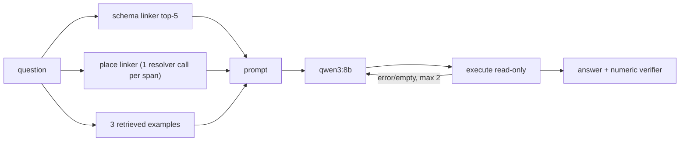
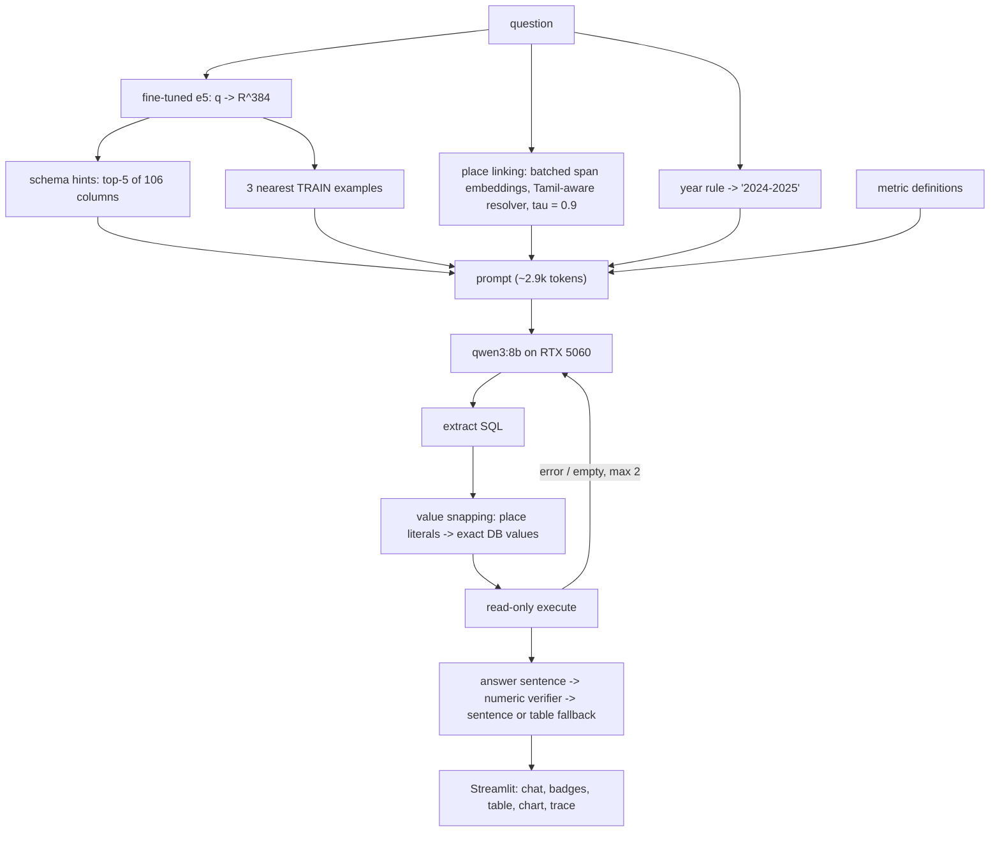

# INGRES — Complete Technical Deep Dive

_Multilingual Text-to-SQL over India's official groundwater assessments. State of the repository on 2026-11-19
(branch `main`, pipeline configuration **v3**). The original system is preserved as git tag `baseline-v1`._

**How to read this document.** Every number comes from a file in the repository; the ledger in
`docs/09_CHANGELOG_AND_EVIDENCE.md` names the command and the file. Labels: **[CODE]** read in source,
**[RUNTIME]** observed by running code, **[BENCH]** produced by a benchmark/evaluation script with stored output,
**[EXT]** external source, **[INF]** inference. Anything not measured is written **NOT MEASURED**.

Supporting documents: `docs/00` audit · `01` model specifications · `02` architecture · `03` features · `04` benchmarks ·
`05` design decisions · `06` reproducibility · `07` interview preparation · `08` roadmap · `09` changelog and evidence.

---

## 1. Executive technical overview

INGRES (India Ground Water Resource Estimation System, CGWB + IIT Hyderabad) publishes, for every assessment unit
(block / taluk / mandal / firka, ≈7,000 per cycle), annual groundwater recharge, extractable resource, extraction for
irrigation / domestic / industrial use, the stage of extraction (%) and a category (Safe, Semi-Critical, Critical,
Over-Exploited, Saline, Hilly Area). The official portal is an English-only map interface without a public download.

This project:
1. **Built the data**: crawled the portal's public JSON endpoint (5,299 requests, 0 failures) into a 9-table SQLite database
   covering 5 assessment cycles (GWRA 2020, 2022–2025), 37 states/UTs, 770 districts, 8,751 assessment units and
   34,565 unit-year rows. National totals equal the government's published figures within 0.07% **[BENCH]**.
2. **Built a benchmark**: INGRES-Bench v1, 371 questions × 4 languages (English, Hindi, Hinglish, Tamil) = 1,484
   question → SQL → result instances, with leakage-controlled splits **[BENCH]**.
3. **Built a system** that answers such questions: a local 8.19 B-parameter LLM (qwen3:8b, 4-bit) writes SQL with
   help from a fine-tuned 117.65 M-parameter multilingual encoder (schema linking and example retrieval), a place-name
   resolver over 9,558 places, a year rule, value snapping, a repair loop, and a numeric verifier for the final sentence.
4. **Measured everything**: accuracy per component, ablations, latency, memory, parameter counts.

Headline accuracy (execution accuracy) **[BENCH]**, all systems run in the same environment:

| | TEST (384) | HARD_TEST (260) |
|---|---|---|
| Keyword/template baseline | 32.6% | 30.8% |
| qwen3:8b zero-shot | 18.0% | 13.1% |
| Original pipeline (`baseline-v1`) | 72.1% | 58.8% |
| **Improved pipeline (v3)** | **81.3%** | **70.4%** |

v3 vs original, paired: 51 wins / 16 losses, McNemar p = 2e-05 (test). Details and caveats: §12, §20.

## 2. Problem formulation

- **Input.** A question string $q$ in English, Hindi (Devanagari), Hinglish (romanised, code-mixed) or Tamil (Tamil
  script, often with Latin place names). Mean length 11.7 words, 23.9 encoder tokens **[BENCH]**.
- **Output.** (a) One read-only SQLite `SELECT` $\hat{s}$ over schema $\mathcal{S}$; (b) its result $R(\hat{s})$; (c) one or two
  sentences in the language of $q$ whose numbers all appear in $R(\hat{s})$.
- **Objective.** Execution accuracy $\mathrm{EX} = \frac{1}{N}\sum_i \mathbb{1}[R(\hat{s}_i) \equiv R(s_i^{*})]$, where
  $\equiv$ is multiset equality of rows (ordered if the gold SQL has an outermost ORDER BY), equal column count, and
  numbers equal within relative tolerance $10^{-6}$ **[CODE `src/evaluation/execution.py:67`]**.
- **Constraints.** Single consumer GPU (RTX 5060, 8 GB); no paid API; no data leaving the machine; SQL must be unable to modify data.
- **Difficulty sources.** Three scripts; 169 unit names shared across states; idiosyncratic spellings (`TAMILNADU`,
  Himachal codes `KNG`); domain conventions ("the 2025 assessment" = cycle `2024-2025`; volumes in hectare-metres,
  1 BCM = 10⁵ ham); IDs that change between cycles.

## 3. Original architecture (baseline-v1)

Accuracy (October run, test / hard_test): **71.9% / 57.7%**. Main weaknesses found by the audit (`docs/00`):
Tamil romanisation bug (B1), no deterministic year handling (55 of 644 SQLs with a wrong year set), place spelling drift
in generated SQL, over-counting of place errors in the error analysis (B3), 16.5 s of the 22–25 s cold start spent
re-embedding aliases, and one transformer call per span during place linking.

## 4. Final architecture (v3)

New in v3 (each measured, §12–13): Tamil romaniser and voicing-neutral matching, year rule, value snapping, metric
definitions, batched place linking with an alias-embedding cache, per-stage timings, and a new UI.

## 5. Complete AI model inventory

| Model | Identity | Parameters (exact) | Architecture | Precision / memory | Role | Trained here? |
|---|---|---|---|---|---|---|
| **qwen3:8b** | Ollama ID `500a1f067a9f`, blob `sha256:a3de86cd…686f`, GGUF v3, Apache-2.0 | **8,190,735,360** (embedding 622.3 M, 36 blocks 6,946.1 M, separate output head 622.3 M) | Decoder-only; 36 layers; hidden 4,096; FFN 12,288; 32 query / 8 KV heads (GQA), head dim 128; RoPE base 10⁶; RMSNorm; vocab 151,936; max context 40,960 (used 8,192) | Q4_K_M: 79.5% Q4_K, 18.7% Q6_K, 1.8% F16; file 5,225,374,496 B (5.10 bits/weight); 6.2 GB in VRAM with 8k context | Writes SQL and answer sentences | No (prompted) |
| **Schema linker** | `intfloat/multilingual-e5-small` (rev `614241f6…`) fine-tuned | **117,653,760** (word embeddings 96,014,208 = 82%) | BERT encoder, 12 layers, 12 heads, hidden 384, FFN 1,536, GELU, 512 absolute positions, mean pooling + L2 | float32, 470,615,040 B in memory | Column ranking; example retrieval | **Yes** (all weights) |
| **Mention embedder** | `intfloat/multilingual-e5-small` | 117,653,760 | same | float32, 470.6 MB | Embedding feature of the place resolver | No |
| **Entity ranker** | scikit-learn `LogisticRegression` | **13** (12 weights + bias) | Linear, L2, C = 1, balanced classes | 812-byte pickle | Scores (mention, candidate place) pairs | **Yes** |
| TF-IDF indexes | `TfidfVectorizer(char_wb, 2–4)` | — | sparse | — | Place candidates (two comparison spaces) | Fitted |

Unused stored parameters: the e5 pooler (147,840) and 35 embedding rows beyond the tokenizer's 250,002 entries.
Gemini (`gemini-3.6-flash`): parameter count NOT PUBLICLY DISCLOSED — CANNOT VERIFY; implemented but not evaluated
(free-tier quota 20 requests/day). Full detail: `docs/01_MODEL_SPECIFICATIONS.md` **[RUNTIME `experiments/forensics/models.json`]**.

## 6. Algorithms and mathematical foundations

### 6.1 Sentence embeddings (e5)
Tokens $x_{1..T}$ → encoder states $H \in \mathbb{R}^{T\times 384}$ → mean pooling over non-padding tokens
$\bar h = \frac{1}{T}\sum_t H_t$ → $e = \bar h / \lVert \bar h \rVert_2$. Questions are prefixed "query: ", schema elements and
aliases "passage: ". Similarity is the dot product of unit vectors (cosine).

### 6.2 Schema linking
Score of element $j$: $s_j = e_q^\top e_j$ for the 115 elements (106 columns, 9 tables); hints = the 5 columns with the
highest $s_j$. **Training** (InfoNCE / multiple-negatives ranking, scale $\tau^{-1} = 20$):
$$\mathcal{L} = -\frac{1}{B}\sum_{i=1}^{B} \log \frac{\exp(20\, e_{q_i}^\top e_{c_i^+})}{\sum_{c \in \mathcal{C}_B} \exp(20\, e_{q_i}^\top e_c)}$$
where $\mathcal{C}_B$ contains all positives in the batch plus 3 hard negatives per pair (semantically adjacent columns,
and the same column at another administrative level). AdamW, lr 2·10⁻⁵, batch 16, 3 epochs, 135 steps, 10% warm-up,
seed 0, 386 s on CPU. Recall@k $= |\text{gold} \cap \text{top-}k| / |\text{gold}|$; MRR $= \frac{1}{|G|}\sum_{g} 1/\text{rank}(g)$.

### 6.3 Example retrieval
$\text{idx} = \operatorname{arg\,top}_3\, TQ\, e_q$ with $TQ \in \mathbb{R}^{612\times384}$ (TRAIN questions). The examples are
shown with their gold SQL, most similar last (closest to the question).

### 6.4 Place resolution
1. **Normalisation** `fold()`: romanise (Devanagari via ISO 15919 with homorganic anusvara; Tamil via the custom
   romaniser), lowercase, map digraphs (aa→a, sh→s, ph→f, kh→k, w→v, …), collapse doubled letters, drop the final inherent
   "a". For Tamil-script mentions, also `devoice()`: g→k, d→t, b→p, j/s→c, h removed.
2. **Candidates**: char 2–4-gram TF-IDF (sublinear tf) cosine in the matching space; top 30 plus exact matches.
3. **Features** (12): TF-IDF cosine; `SequenceMatcher` ratio on folded forms; ratio on consonant skeletons; exact match;
   e5 cosine (mention vs alias); state in context; district in context; state conflict; level one-hot (3); relative length difference.
4. **Ranking**: $p = \sigma(w^\top f + b)$, trained on 18,283 synthetic noisy mentions of 70% of entities (typos,
   transliteration variants, punctuation, automatic Devanagari/Tamil, lowercase), `class_weight = balanced`.
   Strongest weights: edit ratio +18.95, e5 cosine +13.79, state conflict −14.88.
5. **Linking in a question**: all spans of 1–3 words that are not made only of frequent, place-unspecific TRAIN words;
   keep spans with $p \ge \tau = 0.9$ (tuned on DEV for F1); greedy non-overlapping selection by score; re-resolve
   districts and units with the detected state as context.

Complexity per question: $O(S \cdot (V_{tfidf} + 30\cdot L^2))$ for $S$ spans ($\le 3n$), with one batched encoder pass
for all spans (it was $S$ separate passes before v3).

### 6.5 Year rule
Digits in Devanagari/Tamil are mapped to ASCII. Pattern 1: `YYYY-YY` / `YYYY-YYYY` → cycle `YYYY-(YYYY+1)` when the
second number is the next year. Pattern 2: "YYYY [ke/के/…] assessment / आकलन / மதிப்பீட்டில்" → cycle `(YYYY-1)-YYYY`.
Only the 5 cycles present are emitted. Accuracy: 612/612 TRAIN, 228/228 DEV **[RUNTIME]**.

### 6.6 Value snapping
For each comparison `col = 'v'`, `col IN (...)` or `UPPER(col) = UPPER('v')` where col ∈ {state_name, district_name, unit_name}:
exact value present → keep; exactly one case-insensitive match → replace; several (196 unit names exist in two casings) →
the variant the place linker resolved, else `COLLATE NOCASE`; otherwise the stored name with the highest
`SequenceMatcher` ratio on folded forms if ≥ 0.80 and ≥ 0.05 above the runner-up. Wildcard `LIKE` patterns are not touched.

### 6.7 Repair loop
If execution raises an error, returns no rows, or returns a single all-NULL row, the error text is appended as a user
turn ("Executing that query gave: …"), at most 2 times; the loop stops when the model repeats the same SQL.

### 6.8 Numeric verification
Each number $v$ written with $d$ decimals in the answer is supported iff
$\exists r \in \mathcal{R}: |v - r| \le \max(0.5\cdot10^{-d},\ 0.005|r|)$, where $\mathcal{R}$ contains every numeric
result cell and its conversions (÷10⁵ ham→BCM, ×100 and ÷100), numbers in text cells and column headers, the row count,
list positions 1…n, and numbers in the question. Indian digit scripts, grouping (1,23,456) and lakh/crore multipliers are
normalised; years are exempt. Any unsupported number → deterministic table rendering.

### 6.9 Statistics
95% CIs: percentile bootstrap, 2,000 resamples, seed 0. Paired comparisons: McNemar exact test,
$p = 2\cdot\mathrm{Binom}(\min(b,c);\, b+c,\, 0.5)$ over discordant pairs $b, c$. Caveat: the 4 language versions of an
item are correlated, so instance-level CIs are optimistic.

### 6.10 Tokenizer study measures
Fertility $= \#\text{tokens} / \#\text{words}$; fragmentation = share of words split into ≥ 2 tokens;
Code-Mixing Index $\mathrm{CMI} = 100\,(1 - \max_i w_i / (n-u))$ over word-level language tags.

## 7. End-to-end execution trace

Question: **"2024-25 में लुधियाना जिले में कुल भूजल निकासी कितनी थी?"** ("What was the total groundwater extraction in
Ludhiana district in 2024-25?")

| Step | Code | Intermediate output |
|---|---|---|
| Tokenise + encode | `Pipeline.sql` → `SentenceTransformer.encode` | 23 tokens (`<s> ▁que ry : ▁20 24 -25 ▁में ▁लु धि या ना …`) → [1,23,384] → [1,384], norm 1.0 |
| Schema hints | dot product with E [115,384] | `district_assessments.extraction_total_ham` (1st), `district_assessments.natural_discharge_ham`, `state_assessments.extraction_total_ham`, `district_assessments.annual_recharge_ham`, `district_assessments.extraction_irrigation_ham` |
| Place linking | `PlaceLinker.link` | span "लुधियाना" → romanised `ludhiyana` → folded `ludian` → district **`Ludhiana`**, state `PUNJAB`, p = 0.973 |
| Year rule | `year_labels` | `['2024-2025']` |
| Examples | `_examples` | 3 TRAIN (question, SQL) pairs about district-level metrics |
| Generate | `OllamaClient.generate` | `SELECT da.extraction_total_ham FROM district_assessments da JOIN districts d ON d.district_id = da.district_id JOIN states s ON s.state_id = d.state_id WHERE UPPER(d.district_name) = UPPER('Ludhiana') AND s.state_name = 'PUNJAB' AND da.assessment_year = '2024-2025'` |
| Value snapping | `ValueSnapper.snap` | no change (all literals exact) |
| Execute | `safe_sql.execute` | `[(240136.75,)]` |
| Answer | `llm_answer` → `verify` | "2024-25 में लुधियाना जिले में कुल भूजल निकासी 240136.75 हेक्टेयर-मीटर थी।" — 1 number, supported → kept |

Per-stage timings of this question in v3 (live run, 2026-11-19, with the test chain running on the same GPU):
query encoding 11.2 ms, place linking 57.2 ms, SQL generation 2,786 ms (2,480 prompt tokens, 85 output tokens),
SQL execution 1.1 ms, answer sentence + verification 4,956 ms.

A second live trace shows a failure mode. Question (Tamil): "மகபூபாபாத் மாவட்டத்தில் (Telangana) 2019-20 இல் அபாயகரமான
அலகுகள் எத்தனை?" ("How many critical units in Mahabubabad district, Telangana, in 2019-20?").
1. The linker found only `TELANGANA`; it missed the district.
2. The LLM wrote `d.district_name = 'MAHBUBNAGAR'`.
3. Value snapping corrected the spelling to the existing district `Mahabubnagar` (logged as a "spelling" change in the trace).
4. The query returned 1, which happens to equal the right answer for Mahabubabad.

The UI shows the correction, so a user can spot it. EX scores it correct. This is the "lucky" case discussed in §20.

## 8. Full feature inventory

See `docs/03_FEATURES_AND_IMPLEMENTATION.md` for the full table (purpose, implementation, configuration, edge cases,
verification). Summary:

| Area | Features |
|---|---|
| UI | Multilingual chat; verification badge; table + CSV; automatic chart; SQL view with value corrections; pipeline trace with per-stage timings; live ablation switches; examples per language; LLM status; Explore dashboards (no LLM); Results dashboard |
| Pipeline | Schema linking; place linking; retrieved examples; year rule; metric definitions; value snapping; repair loop; numeric verification |
| Data | Crawler; flattening; fresh-water accounting; cross-year crosswalk; granularity table; published-figure reconciliation |
| Evaluation | INGRES-Bench; EX; bootstrap CIs; McNemar; SQL-based error taxonomy; leave-own-intent-out mode; tokenizer study; model forensics; performance benchmark |
| Engineering | Response cache (relocatable); alias-embedding cache; explicit HTTP errors; seeds; frozen baseline tag |

## 9. Architecture decision records

19 ADRs in `docs/05_DESIGN_DECISIONS_AND_TRADEOFFS.md`. The decisions that matter most:

| Decision | Why | Evidence |
|---|---|---|
| Text-to-SQL, not RAG over reports | Exact aggregation; every answer shows its query | EX metric; verifier |
| Local 8B LLM | 20 free API requests/day vs 872 per evaluation; privacy; reproducibility | quota log |
| Small fine-tuned encoder | R@3 0.409 → 0.896; 8.8 ms/question on CPU | `experiments/schema_linking/` |
| Feature LR for places | No labelled data; interpretable; ambiguous names 0.447 → 0.973 | `experiments/entity_resolution/` |
| Retrieved examples | Largest single gain (−36.5 points without them) | `experiments/pipeline/` |
| Deterministic fixes around the LLM (years, snapping, verifier) | Cheap, testable, no extra LLM calls | §12, §13 |
| Rejected: translate-first, vocabulary adaptation | Measured no gain | `experiments/tokenization/` |

## 10. Model training and fine-tuning

| | Schema linker | Entity ranker | LLM |
|---|---|---|---|
| Data | 712 (question, column) pairs from TRAIN (612 instances, 153 items) | 18,283 synthetic mentions of 6,690 entities (70%) | none |
| Licence of data | INGRES public data; benchmark text authored for this project | gazetteer from INGRES | — |
| Objective | InfoNCE with hard negatives, scale 20 | Logistic loss, balanced | — |
| Optimiser / schedule | AdamW 2e-5, 10% linear warm-up, constant after | lbfgs, max 2,000 iterations | — |
| Epochs / batch | 3 / 16 (135 steps) | — | — |
| Hardware / time | CPU (Ryzen 7 9700X), 386 s | CPU, 248 s including evaluation | — |
| Checkpoint selection | Final epoch (no early stopping) | Single fit | — |
| Overfitting checks | Leave-intents-out: R@3 0.851 on unseen question types (3 seeds, 0.75–0.91) | Held-out 30% of entities; real hand-written and historical names | — |

No LoRA/PEFT, no distillation, no LLM fine-tuning. GPU training was not used (CPU build of PyTorch; the RTX 5060 serves the LLM).

## 11. Performance engineering

Method: `scripts/benchmark_perf.py`. 200 TEST questions (50 per language) for CPU components, 100 for LLM and end-to-end.
5 warm-up requests on DEV questions, batch size 1, one request at a time, LLM response cache bypassed, nothing else
running on the GPU. Hardware: Ryzen 7 9700X (16 threads), 32 GB, RTX 5060 8 GB (driver 621.24), Windows 11.

### Components (CPU, 200 TEST questions, 5 warm-up, batch 1)

| Measure | baseline-v1 | optimized | change |
|---|---|---|---|
| Query encoding — mean | 8.50 ms | 8.58 ms | +0.9% (slower) |
| Query encoding — median | 8.48 ms | 8.48 ms | ≈0% |
| Query encoding — p95 | 9.79 ms | 10.15 ms | +3.7% (slower) |
| Query encoding — p99 | 11.10 ms | 10.99 ms | −1.0% |
| Place linking — mean | 107.16 ms | 39.18 ms | −63.4% |
| Place linking — median | 104.81 ms | 37.46 ms | −64.3% |
| Place linking — p95 | 192.41 ms | 70.59 ms | −63.3% |
| Place linking — p99 | 219.26 ms | 81.41 ms | −62.9% |
| Schema ranking — mean | 0.06 ms | 0.06 ms | ≈0% |
| Schema ranking — median | 0.06 ms | 0.05 ms | −16.7% |
| Schema ranking — p95 | 0.07 ms | 0.07 ms | ≈0% |
| Schema ranking — p99 | 0.08 ms | 0.08 ms | ≈0% |
| Example retrieval — mean | 0.06 ms | 0.05 ms | −16.7% |
| Example retrieval — median | 0.06 ms | 0.05 ms | −16.7% |
| Example retrieval — p95 | 0.07 ms | 0.06 ms | −14.3% |
| Example retrieval — p99 | 0.09 ms | 0.08 ms | −11.1% |
| **Total before the LLM** — mean | 115.78 ms | 47.87 ms | −58.7% |
| **Total before the LLM** — median | 113.22 ms | 45.88 ms | −59.5% |
| **Total before the LLM** — p95 | 202.77 ms | 80.41 ms | −60.3% |
| **Total before the LLM** — p99 | 229.06 ms | 91.37 ms | −60.1% |
| Throughput before the LLM (questions/s, 1 thread of requests) | 8.64 | 20.89 | +142% |

### Cold start (seconds)

| Stage | baseline-v1 | optimized, first start (no alias cache) | optimized (alias cache present) |
|---|---|---|---|
| load_finetuned_encoder_s | 0.48 | 0.41 | 0.41 |
| load_base_encoder_s | 4.5 | 4.65 | 4.62 |
| build_place_linker_s | 14.27 | 14.35 | 0.34 |
| build_pipeline_index_s | 2.88 | 2.87 | 2.88 |
| cold_start_total_s | 22.13 | 22.28 | 8.25 |
| RSS after load (MB) | 1295.1 | 1305.9 | 1182.2 |
| Peak RSS (MB) | 1377.6 | 1388.3 | 1322.2 |

### By language — place linking mean (ms)

| Language | baseline-v1 | optimized |
|---|---|---|
| english | 119.1 | 42.12 |
| hindi | 110.94 | 39.27 |
| hinglish | 83.41 | 30.38 |
| tamil | 115.2 | 44.95 |

### Encoder batch scaling (queries/s)

| Batch | baseline-v1 | optimized |
|---|---|---|
| 1 | 140.8 | 143.6 |
| 8 | 287.8 | 288.7 |
| 32 | 297.5 | 299.4 |
| 64 | 274.3 | 288.3 |

### LLM serving (qwen3:8b, RTX 5060, 100 TEST prompts, cache bypassed, streaming)

| Measure | baseline-v1 prompt | v3 prompt |
|---|---|---|
| request wall — mean | 2,198 ms | 2,182 ms |
| request wall — median | 2,009 ms | 2,010 ms |
| request wall — p90 | 2,783 ms | 2,739 ms |
| request wall — p95 | 3,314 ms | 3,279 ms |
| request wall — p99 | 3,781 ms | 3,847 ms |
| time to first token — mean | 289 ms | 293 ms |
| time to first token — median | 281 ms | 285 ms |
| time to first token — p90 | 395 ms | 402 ms |
| time to first token — p95 | 411 ms | 438 ms |
| time to first token — p99 | 444 ms | 452 ms |
| prompt_tokens_mean | 2,343.7 | 2,348.6 |
| output_tokens_mean | 98.7 | 97.8 |
| generation_tokens_per_s | 51.7 | 51.8 |
| prompt_eval_tokens_per_s | 8,762.3 | 8,697.1 |
| requests/s (serial) | 0.45 | 0.46 |
| cold start: model load / first request wall | 3.04 s / 5.77 s | 1.79 s / 4.54 s |
| VRAM in use after run (MiB of 8151) | 7459 | 7459 |

### End to end (`Pipeline.sql`, 100 TEST questions, LLM cache bypassed)

| Measure | baseline-v1 | v3 | change |
|---|---|---|---|
| wall — mean | 2,289.94 ms | 2,303.47 ms | +0.6% (slower) |
| wall — median | 2,084.73 ms | 2,094.78 ms | ≈0% |
| wall — p90 | 2,974.53 ms | 2,890.90 ms | −2.8% |
| wall — p95 | 3,467.73 ms | 3,432.75 ms | −1.0% |
| wall — p99 | 3,840.43 ms | 3,906.11 ms | +1.7% (slower) |
| non-LLM overhead — mean | 120.91 ms | 54.38 ms | −55.0% |
| non-LLM overhead — median | 119.80 ms | 52.05 ms | −56.6% |
| non-LLM overhead — p95 | 198.32 ms | 79.27 ms | −60.0% |
| LLM share of wall time | 94.7% | 97.6% | |
| mean LLM calls per question | 1.0 | 1.0 | |
| questions/s (serial) | 0.44 | 0.43 | |

| Language | baseline-v1 median | v3 median |
|---|---|---|
| english | 2,071 ms | 2,050 ms |
| hindi | 2,097 ms | 2,129 ms |
| hinglish | 2,017 ms | 2,038 ms |
| tamil | 2,200 ms | 2,259 ms |

<!-- baseline_components: commit 79ec245 dirty=False 2026-11-19T13:23:37Z gpu=7490 MiB 7% -->

<!-- optimized_components: commit 6c37a9f dirty=True 2026-11-19T13:34:07Z gpu=7460 MiB 7% -->

<!-- baseline_llm: commit 79ec245 dirty=False 2026-11-19T13:28:22Z gpu=7459 MiB 51% -->

<!-- optimized_llm: commit 6c37a9f dirty=True 2026-11-19T13:38:27Z gpu=7459 MiB 97% -->

<!-- baseline_e2e: commit 79ec245 dirty=False 2026-11-19T13:32:55Z gpu=7459 MiB 98% -->

<!-- optimized_e2e: commit 6c37a9f dirty=True 2026-11-19T13:42:48Z gpu=7458 MiB 97% -->

**Where the time goes (v3, per question):** query encoding ≈9 ms, place linking 39 ms, schema ranking and example
retrieval < 0.1 ms each, SQL execution ≈1–7 ms, LLM 2.01 s median. The LLM is 97.6% of end-to-end time. The
answer sentence is a second LLM call (≈2.5–5 s in the live traces), shown in the UI after the SQL and table.

**Bottlenecks and complexity.** LLM time grows with prompt length (≈2.5–2.9k tokens; prompt processing 8,697 tokens/s)
and output length (≈85–100 tokens at 51.8 tokens/s). Generation dominates: 100 output tokens take ≈1.5 s, while 2.5k
prompt tokens take ≈0.3 s. Place linking is O(spans): up to 3·n spans per n-word question, now one batched encoder call
plus up to 30 `SequenceMatcher` comparisons per span. Memory: two float32 encoders (470.6 MB each) + 24.4 MiB alias matrix.

**Scaling.** Ollama serves one request at a time by default, so throughput is 0.43 questions/s. More users need
parallel slots (`OLLAMA_NUM_PARALLEL`, each needs its own KV cache in VRAM; not measured), a larger GPU, or a server with
continuous batching (vLLM). The encoders and SQLite are not the limit.

## 12. Before/after benchmark comparison

### 12.1 Accuracy (execution accuracy; same environment for every row; TEST/HARD_TEST run once after design on DEV)

| System | DEV (228) | TEST (384) | HARD_TEST (260) |
|---|---|---|---|
| Keyword/template baseline | 58.3% | 32.6% | 30.8% |
| qwen3:8b zero-shot | 24.6% | 18.0% | 13.1% |
| Original pipeline (`baseline-v1`, re-run Nov 2026) | — | 72.1% | 58.8% |
| + Tamil-aware resolver (`full`) | 77.2% | 74.7% | 59.6% |
| + year rule (`v2`) | 83.3% | 78.4% | 61.5% |
| **+ value snapping + metric definitions (`v3`)** | **92.1%** | **81.3%** [77.3, 85.2] | **70.4%** [65.0, 75.8] |
| v3 with same-type examples hidden (`v3_loio`) | 55.7% | 51.0% | — |
| same, with 6 examples instead of 3 (exploratory) | 59.2% | not run | — |

- v3 vs original (paired McNemar): test 51 wins / 16 losses, McNemar p = 2e-05; hard_test 42 wins / 12 losses, McNemar p = 5e-05.
- Step by step on TEST (paired): resolver fix 12 wins / 2 losses, McNemar p = 0.013; + year rule 21 wins / 7 losses, McNemar p = 0.013;
  + value snapping and definitions 24 wins / 13 losses, McNemar p = 0.099. The last step was strongly significant on DEV (23 / 3, p = 9e-5) but
  is not significant at 0.05 on TEST. Part of its DEV gain came from DEV-specific error patterns: the definitions note
  targeted a question type frequent in DEV, and on TEST it sometimes added extra columns. On HARD_TEST the order reverses: resolver fix 58.8 → 59.6 (4/2, p = 0.69), year rule → 61.5 (10/5, p = 0.30), value snapping + definitions → 70.4 (34/11, p = 0.0008). The steps are complementary: on clean TEST questions the resolver fix and year rule carry the gain; on noisy questions with misspelled names, value snapping does.
- Errors on TEST + HARD_TEST, original → v3: total 214 → 149; gold place missing from SQL 72 → 37; wrong year 35 → 12;
  other logic 76 → 62; wrong metric 20 → 22; wrong aggregation 7 → 11; execution errors 4 → 5.
- v3 by language (test): English 90.6, Hindi 75.0, Hinglish 84.4, Tamil 75.0. Original: English 79.2, Hindi 69.8, Hinglish 77.1, Tamil 62.5.
- v3 by difficulty (test): simple lookup 73.3, filtered aggregate 90.4, cross-year 78.3, multi-hop 75.0.
- First-attempt EX (no repair) for v3: test 81.0%, hard_test 70.0%. The repair loop now adds little because value
  snapping prevents most of the failures it used to see.
- Value snapping changed 22 test and 51 hard_test queries. Hard_test contains deliberately misspelled names.
- "Lucky" correct answers (scored correct although the SQL lacks a gold place literal): 4 of 495 (0.8%).
- The October and November runs of the original code do not differ significantly (test 71.9 → 72.1%, p = 1.0;
  84.8% identical SQL strings), so the environment change is not the source of the gain.

- **Post-evaluation bug fix (v3.1, the shipped code).** The UI trace exposed a place-linker bug inherited from baseline-v1: the second pass kept its re-resolution whatever its score ("शीर्ष" → SIRSA at 0.0). Fixed (C-18), with a regression test. Measured afterwards with cached replays, so only affected questions called the LLM: DEV 92.1 → 94.3% (5 fixed / 0 broken), TEST 81.3 → 81.5% (1 / 0), HARD 70.4 → 71.2% (2 / 0). v3 stays the headline because it was frozen before the single TEST evaluation.

### 12.2 Components

| Component | Before | After |
|---|---|---|
| Resolver, hand-written Tamil top-1 (no ctx / ctx) | 0.568 / 0.645 | **0.806 / 0.857** (128 fixed, 5 broken, p = 6e-32) |
| Resolver, synthetic automatic Tamil (no ctx / ctx) | 0.688 / 0.768 | 0.841 / 0.902 |
| Resolver, hand-written Hindi (no ctx / ctx) | 0.780 / 0.835 | 0.817 / 0.857 |
| Place linker DEV F1 (τ = 0.9) | 0.852 (Tamil 0.654) | **0.905** (Tamil 0.833) |
| Year-cycle labels correct (TRAIN / DEV) | left to the LLM | 612/612, 228/228 |
| SQL with a wrong year set (test + hard) | 55 / 644 (Oct run), 53 / 644 (Nov re-run) | 15 / 644 |

### 12.3 Performance
See §11 (tables generated from `experiments/perf/*.json`).

## 13. Optimization decisions

| # | Optimization | Reason | Implementation | Effect |
|---|---|---|---|---|
| O-1 | Batch all span embeddings of a question into one encoder call | Place linking was 93% of pre-LLM time; one transformer call per span | `Resolver.embed` + `resolve(m_emb=...)` | Place linking 107 ms → 39 ms |
| O-2 | Cache the 16,681 alias embeddings on disk (hash of the alias list) | Re-embedding at every start took most of the cold start | `Resolver(emb_cache=...)` | Cold start 22.1 s → 8.3 s (first start without cache: 22.3 s) |
| O-3 | Precompute TF-IDF candidate similarities once per mention and reuse them as a feature | Similarities were computed twice | `_cands` returns the scores | Included in O-1 |
| O-4 | Value snapping instead of extra LLM repair turns | Deterministic, ≈0.1 ms per query, no LLM call | `ValueSnapper` | Fewer repair turns: v3 DEV mean 0.05 vs 0.13 for `full` |
| — | Not done: ONNX/int8 encoders, GPU encoders, KV-cache prefix reuse tuning, parallel Ollama slots | Encoders ≈1% of request time; GPU full with the LLM | — | Deferred (ADR-19) |

Accuracy improvements (C-01, C-05, C-09, C-10) are in §12.1; their rationale is in ADR-13 to ADR-16.

## 14. Dependencies and technology stack

| Package | Version | Purpose |
|---|---|---|
| Python | 3.12.10 | runtime |
| torch | 2.14.0 (CPU build) | encoder inference and fine-tuning |
| transformers / sentence-transformers / tokenizers | 4.57.6 / 3.1.0 / 0.22.2 | e5 encoder, tokenizers |
| huggingface_hub / safetensors | 0.36.2 / 0.8.0 | model download and weights |
| scikit-learn | 1.9.1 | TF-IDF, logistic regression, Naive Bayes |
| scipy | 1.17.1 | McNemar (binomtest), Spearman |
| pandas / numpy / pyarrow | 2.3.3 / 2.5.3 / 25.0.1 | data processing |
| indic-transliteration | 2.3.69 | Devanagari romanisation, transliteration checks |
| streamlit / altair | 1.38.0 / 5.5.0 | UI and charts |
| pytest | 9.1.1 | tests |
| matplotlib, python-docx, python-pptx, reportlab | 3.11.2, 1.2.0, 1.0.2, 4.2.2 | figures and reports |
| Ollama | 0.35.1 | LLM serving (llama.cpp backend), not a pip package |

Compatibility note: `requirements.txt` pins numpy 1.26.4 (October); the current environment runs numpy 2.5.3 and all 69 tests pass.

## 15. Data architecture

| Item | Detail |
|---|---|
| Raw | `data/raw/ingres_api/<year>/<LOCTYPE>_<uuid>.json.gz`, 5,299 files, 139.4 MB snapshot with SHA-256 manifest (local) |
| Interim | `facts_long.parquet` (6,217,844 rows), `locations.parquet` |
| Canonical DB | `ingres.db`, 21.8 MB, 9 tables (see `docs/02` §2) |
| Schema doc | `data/schema/schema.json`: descriptions, units, null rates, examples; uncertain semantics marked UNCERTAIN |
| Benchmark | `data/benchmark/ingres_bench_v1.jsonl` + one file per split |
| Caches | `cache/llm*/` (responses, JSON per request), `cache/alias_emb/` (24.4 MiB) |
| Privacy | Public government data only; no user data stored except the chat in the browser session |

## 16. APIs and interfaces

| Interface | Usage |
|---|---|
| Python | `Pipeline(con, train_rows, **flags).answer(question) -> dict` with keys `answer, source, verification, sql, first_sql, attempts, hints, places, years, columns, rows, latency_s, prompt_tokens, output_tokens, timings_ms` |
| Flags | `schema_hints, places, fewshot, year_hints, domain_notes, snap_values` (all True), `max_repairs=2, k_cols=5, k_shots=3, model="qwen3:8b"` |
| LLM | Ollama `POST http://127.0.0.1:11434/api/chat` (non-streaming in the pipeline) |
| UI | `streamlit run app/streamlit_app.py` → http://localhost:8501 |
| CLI | `scripts/*.py` (one per experiment), listed in `docs/06_REPRODUCIBILITY.md` |
| Env vars | `INGRES_LLM_CACHE` (response cache dir), `GEMINI_API_KEY` (optional, `.env`) |

No HTTP API or authentication exists; the app is a single-user local demo.

## 17. Reliability and security

| Risk | Control | Status |
|---|---|---|
| Destructive or exfiltrating SQL | Read-only URI + authorizer allow-list + denied functions | 13 tests |
| Runaway SQL | 10 s progress-handler timeout, 10,000-row cap | CODE |
| Prompt injection in the question | Can only change the read-only query or the sentence; sentence numbers are verified | INF |
| Hallucinated numbers | Numeric verifier + fallback | 98.1% detection, 0% false alarms |
| LLM unavailable | UI degrades to Explore/Results; explicit HTTP errors | CODE |
| `pickle.load` of the ranker | File is local and tracked in git; would execute code if replaced | known risk |
| Undocumented upstream endpoint | Raw snapshot + manifest | local only |

## 18. Testing and validation
69 tests in 11 files (`python -m pytest`, 8–9 s; counts from `pytest --collect-only`): SQL safety 17, crosswalk 8,
modernization regressions 8 (Tamil romanisation, devoicing, anusvara, resolver ranking, year rule, SQL-based error
categories, value snapping ×2), DB vs published figures 6, ingestion 6, grounding 6, EX metric 4, linking and
resolution 4, tokenization 4, benchmark QC 3, repair loop 3. Model evaluation scripts are listed in §19; all their outputs are stored.

## 19. Reproducibility
`docs/06_REPRODUCIBILITY.md`: environment, setup, assets outside git, every command, seeds, and the
determinism finding: temperature-0 generation is identical within one environment (39/39) but not across GPU-driver
versions (24/39 identical between October and November with the same model ID). All before/after comparisons in §12 are
therefore run in the same environment.

## 20. Limitations and failure analysis

### 20.1 Where v3 still fails (149 errors on TEST + HARD_TEST, rule-based categories on the predicted SQL)

| Category | Errors | English | Hindi | Hinglish | Tamil | Notes |
|---|---|---|---|---|---|---|
| Other SQL logic | 62 | 14 | 15 | 14 | 19 | 24 extra columns (output shape), 16 different row count (filter/join), 18 same shape but different values, 4 missing columns |
| Gold place literal missing from SQL | 37 | 5 | 11 | 8 | 13 | 32 of 37 are **unit** (block/taluk) names; the linker had missed the place in 34 of 37 |
| Wrong metric / column | 22 | 1 | 8 | 6 | 7 | |
| Wrong assessment year | 12 | 1 | 6 | 3 | 2 | was 55 SQLs with a wrong year set in the original |
| Wrong aggregation | 11 | 4 | 3 | 3 | 1 | |
| No SQL / execution error | 5 | 0 | 1 | 0 | 4 | |

Most frequent question types among errors: unit metric (21), unit category (19), unit category in two years (14), units
over-exploited in all years (14). Noise matters: on HARD_TEST, v3 scores 81.4% on clean and 67.2% on noisy instances.

### 20.2 Limitations
1. **Template overlap.** 376/384 TEST instances share their question type with TRAIN. With same-type examples hidden,
   v3 scores 51.0% (vs 81.3%). Accuracy on genuinely new question types is closer to the lower number.
2. **Benchmark text** is template-generated and not checked by native speakers.
3. **EX can reward lucky answers.** 4 of 495 correct v3 answers have SQL without the gold place literal (e.g. two districts
   with the same count).
4. **One LLM, quantised.** Q4_K_M qwen3:8b only; the frontier upper bound and the cost of quantisation are NOT MEASURED.
5. **GPU nondeterminism across environments.** 24/39 identical answers between October and November with the same model
   ID; results are compared within one environment.
6. **Instance-level CIs are optimistic** (4 language versions per item are correlated).
7. **Single training seed** for the schema linker and the ranker.
8. **Single-user app**; no authentication, no HTTP API, no concurrency measurements.
9. **The numeric verifier** checks that numbers exist in the result, not which entity they describe.

### 20.3 Unsuccessful experiments (kept in the record)
Translate-first (−1.8 points, n.s.); vocabulary adaptation (no gain); 6 instead of 3 retrieved examples for unseen question types (DEV 55.7 → 59.2%, p = 0.12, not adopted); Gemini free tier (20 requests/day, unusable);
qwen2.5-coder:7b (3/24 on the pilot vs 8/24 for qwen3:8b).

## 21. Future research directions
Full table with success criteria: `docs/08_FUTURE_RESEARCH_ROADMAP.md`. Top three, by the error analysis above:
1. **Unit-name linking** (32 of 149 errors): level words as features ("block", "ज़िला", "மாவட்டம்"), unit aliases in
   Devanagari/Tamil, and passing the top-3 unit candidates instead of the top-1 when confidence is low.
2. **Output-shape control** (24 errors with extra columns): detect "which/list" questions and re-ask once, or prune
   columns that the question does not mention.
3. **Generalisation** (81.3% → 51.0% without same-type examples): pattern-level examples or QLoRA on TRAIN SQL.

## 22. Technical interview deep dive
Same content as `docs/07_TECHNICAL_INTERVIEW_PREPARATION.md` (46 questions).

### 22.A Problem and data

**1. What exactly does INGRES do?**
It answers questions about India's official groundwater assessments, asked in English, Hindi, Hinglish or Tamil. It
translates each question into one read-only SQL query over a local copy of the INGRES data, runs it, and writes a
one-sentence answer whose numbers are checked against the query result. It is Text-to-SQL, not a chatbot over documents.

**2. Where does the data come from, and how do you know it is right?**
From the INGRES portal's public JSON endpoint, found by reading the portal's JavaScript: 5,299 requests, 0 failures. The
database reproduces the government's published national totals within 0.07% for four cycles (for example GWRA 2025
extraction 247.22 vs 247.22 BCM). An automated test checks this. The UI's Explore page shows 60.6% stage of extraction
for 2024-25, against 60.63% published.

**3. Why was 2016-17 excluded?**
Four states were missing and national totals came out about twice the published values.

**4. Why do you need a cross-year crosswalk?**
INGRES re-issues unit IDs in some cycles: only 14% of unit IDs survive from 2019-20 to 2021-22. A four-stage matcher
(ID → name in district → name in state → guarded fuzzy) links them. A hand check of 40 fuzzy links found 37 correct.

**5. What is the benchmark, and how did you prevent leakage?**
INGRES-Bench v1: 371 questions × 4 languages = 1,484 instances, 38 question types, 4 difficulty levels. Splits are by
item (all languages of a question together), test places are mostly unseen, and one phrasing per type is held out of
train/dev. QC verifies that no SQL or question text crosses splits.

**6. The questions were written with an LLM. Is that valid?**
The SQL and answers come from the real database, and the 4 language versions share the same slots, so meaning cannot
drift between languages. QC had 0 failures, and the slot checker catches 97.1% of deliberately corrupted questions. The
limitation is real: the wording is template-like, and no native speaker has checked it.

### 22.B Models and parameters

**7. Which models does the system use?**
(1) qwen3:8b via Ollama: writes SQL and answer sentences. (2) multilingual-e5-small, fine-tuned: schema linking and
example retrieval. (3) multilingual-e5-small, off-the-shelf: an embedding feature for place resolution. (4) A logistic
regression with 13 parameters: ranks place candidates. Plus char-n-gram TF-IDF indexes for candidate generation.

**8. How many parameters does the LLM have, and how do you know?**
8,190,735,360, counted from the shapes of all 399 tensors in the GGUF file Ollama loads (`scripts/model_forensics.py`):
622,329,856 for the token embedding, 6,946,071,552 in 36 blocks, and 622,333,952 for the separate output head plus
final norm. It is not taken from a model card.

**9. How is it quantised?**
Q4_K_M: 79.5% of parameters in 4-bit k-quants and 18.7% in 6-bit (Q6_K: the output head, 622.3 M, plus half the
FFN down-projections, 18 of 36 layers, 906.0 M). The attention value projections of all 36 layers (151.0 M, 1.8%) are
F16, and norms are F32. The file is 5,225,374,496 bytes, about 5.10 bits per weight. With an 8,192-token context it uses
6.2 GB on the 8 GB RTX 5060.

**10. Describe the LLM's architecture.**
Decoder-only, 36 layers, hidden size 4,096, FFN 12,288. Grouped-query attention with 32 query heads and 8 key/value
heads (head dim 128), which shrinks the KV cache 4×. RoPE with base 10⁶, RMSNorm, vocabulary 151,936, maximum context
40,960. We use 8,192 so the model and KV cache fit in VRAM.

**11. How many parameters does the encoder have, and where are they?**
117,653,760. 96,014,208 (82%) are the word-embedding table (250,037 × 384, multilingual vocabulary). 21,293,568 are in 12
transformer layers, 196,608 are position embeddings, 1,536 are token-type embeddings and LayerNorm, and 147,840 are a
pooler that is loaded but unused because we mean-pool.

**12. What was fine-tuned, and what was not?**
All 117.65 M encoder parameters were fine-tuned for schema linking (none frozen). The 13-parameter ranker was trained.
The LLM was only prompted. No LoRA, adapters or distillation.

**13. Why a 4-bit 8B model and not GPT/Claude/Gemini?**
The Gemini free tier allowed 20 requests per day (logged), and one evaluation pass is 872 requests. A local model is
free, private, and reproducible within an environment. The cost is accuracy: the frontier upper bound is not measured.

### 22.C Algorithms

**14. How does schema linking work?**
The question and each of 115 schema elements (106 columns, 9 tables, described in English) are embedded by the encoder.
Elements are ranked by cosine similarity, and the top 5 columns go into the prompt as hints.

**15. How was the schema linker trained, and what is a hard negative?**
InfoNCE (multiple-negatives ranking) with similarity scale 20 on 712 TRAIN (question, column) pairs. Each pair gets 3
hard negatives: columns easy to confuse with the right one (extraction vs stage of extraction; recharge vs extractable
resource) and the same column at another level (unit vs district vs state table). AdamW, lr 2e-5, batch 16, 3 epochs,
386 s on CPU.

**16. How do you know it didn't just memorise question types?**
We removed 25% of question types from training and tested only on those: recall@3 0.851 (3 seeds, range 0.75–0.91)
versus 0.454 off-the-shelf.

**17. How does place resolution work?**
Fold the mention (romanise, lowercase, normalise digraphs, collapse doubled letters, drop the final inherent "a") and
retrieve 30 candidates by character 2–4-gram TF-IDF. Score each candidate with logistic regression over 12 features:
TF-IDF cosine, edit ratio, consonant-skeleton ratio, exact match, e5 cosine, whether the candidate's state/district is
mentioned, state conflict, level, and length difference.

**18. How do you handle a name like "Ramnagar" that exists in 10 states?**
Hierarchy context. If the question mentions a state, candidates in that state get a strong positive feature and
candidates elsewhere a strong negative one (−14.9). Top-1 on ambiguous names: 0.447 without context, 0.973 with it.

**19. What was the Tamil bug, and how did you find it?**
The transliteration library's Tamil→ISO scheme reads Tamil stops as voiced aspirates: கர்நாடகா became "gharnadhagha".
Probing the resolver with Tamil state names, scores were 0.03–0.32, far below the 0.9 threshold. The fix is a small
Tamil romaniser (unvoiced reading) plus a "devoiced" comparison space for Tamil-script mentions, because Tamil writes
k/g, t/d and p/b with one letter. Hand-written Tamil top-1 went 0.568 → 0.806 (128 fixed, 5 broken, p = 6e-32).

**20. What is value snapping?**
After the LLM writes SQL, every literal compared with state_name, district_name or unit_name is checked against that
column. An exact value is kept. A case variant is replaced by the stored spelling. A close misspelling (folded
similarity ≥ 0.80, clearly better than the runner-up) is replaced by the stored name. It exists because the model
rewrote correct spellings it was given ('Mahabubabad' → 'MAHABUBABAD'), and a COUNT over zero rows returns 0, so the
repair loop never saw the error. Replayed on dev outputs: 12 errors fixed, 0 correct answers broken.

**21. Why is the year rule a hint and not an SQL rewrite?**
Some questions compare two years, and the model still has to decide where each year goes. The rule only states which
cycle labels the question means; for example "the 2025 assessment" is `2024-2025`. It is 100% correct on TRAIN and DEV.

**22. How does the repair loop work, and what doesn't it catch?**
If the SQL fails, returns no rows, or returns one all-NULL row, the error text goes back to the model (at most 2 times;
it stops if the model repeats itself). It cannot catch a wrong but non-empty result, such as a COUNT of 0 caused by a
misspelled place. That is why value snapping exists.

**23. How does the numeric verifier work?**
Every number in the answer sentence must equal a value in the result, within the precision it is written with or 0.5%,
after unit conversions (ham ↔ BCM, fraction ↔ percent), Indian digit scripts, 1,23,456 grouping and lakh/crore. Row
counts, list positions and numbers from the question are also allowed; years are exempt. If any number fails, the
sentence is replaced by a plain rendering of the table.

**24. How good is the verifier?**
It caught 98.1% of 215 deliberately planted numeric errors, with 0% false alarms on 384 grounded answers. The LLM put an
unsupported number in 0.83% of answers (2 of 242), both real errors, both caught.

**25. Why execution accuracy rather than exact SQL match?**
Many SQL strings are correct for the same question. EX compares results: multisets of rows, order only when the gold SQL
sorts, numbers within 1e-6 relative, same number of columns.

**26. How do you test significance?**
Paired McNemar exact tests on the same questions, counting questions one system gets right and the other wrong.
95% bootstrap CIs with 2,000 resamples. CIs are optimistic, because the 4 language versions of an item are correlated.

### 22.D Results and ablations

**27. What are the headline results?**
Test EX (384): keyword baseline 32.6%, LLM zero-shot 18.0%, original pipeline 72.1% (re-run in November;
71.9% in October), improved pipeline v3 **81.3%**. hard_test (260): 58.8% → **70.4%**.
Paired v3 vs original (test): 51 wins / 16 losses, McNemar p = 2e-05.

**28. Which component matters most?**
Retrieved examples: removing them from the original pipeline dropped test EX from 71.9% to 35.4% (p = 2e-30). Next are
the deterministic fixes around the LLM, measured step by step in one environment. TEST: original 72.1% → Tamil-fixed
resolver 74.7% (12/2, p = 0.013) → + year rule 78.4% (21/7, p = 0.013) → + value snapping and metric definitions 81.3%
(24/13, p = 0.099). On DEV the last step looked much larger (83.3 → 92.1%), so part of its DEV gain did not transfer.

**29. Isn't the accuracy inflated by retrieved examples of the same question type?**
Partly, and it was measured. With every training example of the question's own type hidden (`v3_loio`), test EX is
51.0% versus 81.3%. The remaining gap is what the model gains from seeing the same SQL pattern. The keyword
baseline has the same advantage and scores 32.6%.

**30. Why did translating to English first not help?**
The 8B model mistranslated domain terms: अति-दोहित ("over-exploited") became "extremely undernourished", and
எடுப்பு நிலை ("stage of extraction") became "attendance level". The result was 16.4% vs 18.2% direct.

**31. Does tokenizer fragmentation explain worse Hindi/Tamil accuracy?**
No. Qwen3 uses 8.96 tokens per Tamil word against 2.04 for English, but fertility correlates with accuracy only weakly
(ρ ≈ −0.09). A placebo (the keyword baseline, which has no subword tokenizer) correlates more strongly (−0.18), so the
correlation reflects language and item difficulty. Vocabulary adaptation cut Tamil fragmentation 0.63 → 0.43 with no
accuracy gain.

**32. Where does v3 still fail?**
v3 errors on test + hard_test: 149 errors: other (filters, joins, output shape) 62; gold place literal missing from SQL 37; wrong metric / column 22; wrong assessment year 12; wrong aggregation 11; no SQL / execution error 5. Categories are assigned by rules on the predicted SQL (first match wins).

**33. Why did you re-run the original system?**
Re-installing the same model ID with a newer GPU driver reproduced only 24 of 39 October answers exactly, while two
runs in one environment matched 39/39. Comparing October numbers with November numbers would mix environments, so the
original code (tag `baseline-v1`) was re-run with an empty cache in the same environment as v3.

### 22.E Performance and engineering

**34. How fast is it?**
LLM request (100 test questions, cache bypassed): median 2.01 s, mean 2.18 s, p95 3.28 s; time to first token
median 285 ms; generation 51.8 tokens/s; prompt processing 8,697 tokens/s. End-to-end `Pipeline.sql` median 2.09 s.

**35. What is the bottleneck?**
The LLM: 97.6% of wall time. Before the LLM, place linking dominated: 107 ms of 116 ms per question
in the original code; now 39 ms of 48 ms.

**36. What did you optimize, and by how much?**
(a) All candidate spans embedded in one batched forward pass instead of one per span. (b) The 16,681 alias embeddings
cached on disk. Cold start 22.1 s → 8.3 s; pre-LLM mean 116 ms → 48 ms; pre-LLM throughput 8.6 → 20.9 questions/s.
End-to-end latency did **not** change (median 2,085 → 2,095 ms), because the LLM is 97.6% of it.

**37. How much memory does it use?**
Python process: 1,182 MB resident after loading (two float32 e5 copies at 470.6 MB each, the 24.4 MiB alias matrix,
TF-IDF indexes). Ollama: 6.2 GB for qwen3:8b with an 8,192-token context; GPU total in use during runs about 7.3–7.5 GB of 8.15 GB.

**38. Why not run the encoders on the GPU or with ONNX?**
They take about 9 ms of a request of about 2 s, and the GPU is full with the LLM. The best-case saving is under 1% end to end.

**39. How would you scale to many users?**
Ollama serves one request at a time by default, so throughput is about 0.5 questions per second on this GPU. Options:
`OLLAMA_NUM_PARALLEL` (more KV-cache VRAM per slot), a bigger GPU, or vLLM with continuous batching; the encoders can be
shared, and the SQL is cheap. None of these is measured here.

**40. How is the SQL kept safe?**
A read-only connection plus a SQLite authorizer callback that allows only SELECT/READ/FUNCTION/RECURSIVE, denies
`load_extension`/`readfile`/`writefile`, aborts after 10 s and caps results at 10,000 rows. It is enforced by SQLite
itself, not by string filtering. 13 injection and write attempts are tested.

**41. How do you make results reproducible?**
Seeds everywhere, temperature 0, a fixed model ID, a response cache keyed by the full request, a frozen baseline tag,
and the environment recorded in every benchmark file. Cross-environment GPU nondeterminism was measured (24/39) and is
handled by comparing within one environment.

**42. Why Streamlit?**
It was already a dependency. Chat components, Altair charts and tables are built in, so the whole UI is one Python
file. A FastAPI + React stack would add work without benefit for a single-user demo.

**43. What does the UI show besides the answer?**
A verification badge, the result table with CSV download, an automatic chart, the SQL with any value corrections, and a
trace (schema hints, resolved places, year labels, attempts, time per stage). There are switches to turn components off
live, an Explore page with dashboards straight from the database, and a Results page.

### 22.F Critical thinking

**44. What would you do next?**
Measure and improve generalisation to unseen question types (pattern-level examples, or QLoRA on TRAIN SQL), get native
speakers to check a sample of each language, measure a frontier-model upper bound on TEST, and add level words
("block", "ज़िला") as a resolver feature.

**45. What is the weakest part of your evaluation?**
The benchmark is template-generated and its test question types overlap with training. The leave-own-intent-out run
measures part of this; a truly held-out question-type split, plus real user questions, would be better evidence.

**46. What makes this project technically distinctive?**
A verified data layer (published totals reproduced within 0.07%), a four-language benchmark built for this domain, and
measured components with paired significance tests. Bugs found by measurement were fixed with regression tests (the
Tamil romanisation, a misleading error taxonomy). Deterministic safeguards wrap the LLM (year rule, value snapping,
numeric verifier, read-only execution), each justified by error analysis on dev and evaluated once on test.

## 23. Resume and portfolio evidence
Each bullet is backed by a stored result (ledger: `docs/09`).
- Built a multilingual (English/Hindi/Hinglish/Tamil) Text-to-SQL system over India's official groundwater data. It raised
  execution accuracy from 72.1% to **81.3%** on a 384-question test set (51 wins / 16 losses, McNemar p = 2e-05) and from
  58.8% to 70.4% on a noisy hard set, using a local 8.19 B-parameter LLM on one 8 GB GPU.
- Crawled and reconciled 5 assessment cycles (5,299 API responses, 6.2 M facts) into a 9-table SQLite database whose
  national totals match the government's published figures within 0.07%.
- Created INGRES-Bench: 1,484 question→SQL instances in 4 languages with leakage-controlled splits; QC with 0 failures and
  a mutation test catching 97.1% of corrupted questions.
- Fine-tuned a 117.65 M-parameter multilingual encoder with domain hard negatives for schema linking: recall@3 0.409 →
  0.896 (0.851 on unseen question types); its hints add +5.2 accuracy points (p = 0.008).
- Found and fixed a Tamil transliteration bug through measurement: hand-written Tamil place-name accuracy 0.568 → 0.806
  (128 fixed, 5 broken).
- Designed deterministic safeguards around the LLM (year rule, value snapping, metric definitions, numeric verifier):
  DEV accuracy 77.2% → 92.1%; the numeric verifier catches 98.1% of planted numeric errors with 0% false alarms.
- Cut pre-LLM latency 116 ms → 48 ms per question and cold start 22.1 s → 8.3 s
  by batching span embeddings and caching 16,681 alias embeddings.
- Shipped a 3-page Streamlit app: multilingual chat with verification badges, charts, SQL and trace, live component
  ablations, and data dashboards that reproduce published national figures.

## 24. Complete technical fact sheet

| Item | Value | Source |
|---|---|---|
| Data | 5 cycles (2019-20, 2021-22 … 2024-25); 37 states/UTs; 770 districts; 8,751 units; 34,565 unit-year rows | DB |
| Crawl | 5,299 requests, 0 failures, ≈80 min; 6,217,844 flattened facts | data audit |
| Published-figure match | ≤ 0.07% (4 cycles) | test |
| Benchmark | 371 items × 4 languages = 1,484; splits 612 / 228 / 384 / 260; 38 question types | benchmark |
| LLM | qwen3:8b, 8,190,735,360 params, 36 layers, d = 4,096, 32/8 heads (GQA), vocab 151,936, ctx 40,960 (used 8,192), Q4_K_M 5.23 GB file, 6.2 GB VRAM | forensics |
| Encoder | multilingual-e5-small, 117,653,760 params (82% embeddings), 12 layers, d = 384, 12 heads, FFN 1,536, 512 positions, 384-d output, float32 470.6 MB | forensics |
| Ranker | Logistic regression, 13 parameters, 12 features, 18,283 training mentions | forensics |
| Schema linker training | 712 pairs, InfoNCE scale 20, 3 hard negatives, AdamW 2e-5, batch 16, 3 epochs, 386 s CPU | training log |
| Schema linking | R@3 0.896 (BM25 0.267, off-the-shelf 0.409); unseen types 0.851 | experiments |
| Place resolver | ambiguous 0.447 → 0.973 with context; hand-written Tamil 0.806 / 0.857 (no ctx / ctx) | experiments |
| Place linker | DEV F1 0.905 at τ = 0.9 (P 0.915, R 0.895) | experiments |
| Numeric verifier | 98.1% planted-error detection, 0% false alarms, 0.83% → 0% unsupported numbers | experiments |
| Accuracy, original → v3 | TEST 72.1% → 81.3%; HARD 58.8% → 70.4%; DEV 77.2 → 92.1 (fix steps) | experiments |
| Shipped v3.1 (+ place-linker fix) | TEST 81.5%, HARD 71.2%, DEV 94.3% | experiments |
| v3 by language (TEST) | English 90.6, Hindi 75.0, Hinglish 84.4, Tamil 75.0 | experiments |
| v3, own question type hidden | 51.0% | experiments |
| Latency | pre-LLM 116 ms → 48 ms; LLM request median 2.01 s; TTFT 285 ms; 51.8 tok/s; end-to-end median 2.09 s | perf |
| Cold start / memory | 22.1 s → 8.3 s; RSS 1,182 MB; VRAM ≈7.3–7.5 of 8.15 GB during runs | perf |
| Tests | 69 (pytest) | tests |
