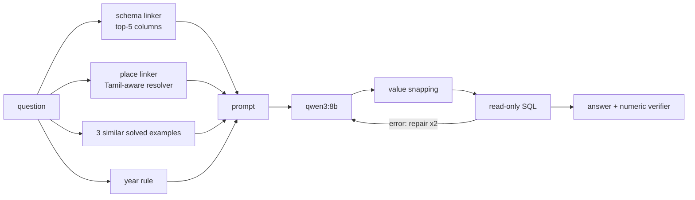

# INGRES-Text2SQL

Ask questions about India's official groundwater assessments in **English, Hindi, Hinglish or Tamil** and get a
verified answer, the SQL that produced it, and the data. Built over the **INGRES** database (CGWB + IIT Hyderabad).

> **Accuracy (execution accuracy, test split, 384 questions):** improved pipeline v3 **81.3%** · original pipeline
> 72.1% · keyword/template baseline 32.6% · LLM alone 18.0%. Hard test (260): 70.4% vs 58.8%.
> The shipped code (v3.1, with one later place-linker bug fix) scores 81.5% / 71.2%.
> Everything runs locally: qwen3:8b (8.19 B parameters, 4-bit) on one RTX 5060 + a fine-tuned 117.65 M-parameter encoder.

**Documentation**
- [`INGRES_COMPLETE_TECHNICAL_DEEP_DIVE.md`](INGRES_COMPLETE_TECHNICAL_DEEP_DIVE.md): the complete technical reference
  (models, algorithms, execution trace, benchmarks, decisions, interview Q&A, fact sheet).
- [`PROJECT_OVERVIEW.md`](PROJECT_OVERVIEW.md): the project explained for the team and examiners.
- `docs/00`–`09`: baseline audit, model specifications, architecture, features, benchmarks, design decisions,
  reproducibility, interview preparation, roadmap, changelog and evidence ledger.
- Phase reports: [`DATA_ACCESS_REPORT`](docs/DATA_ACCESS_REPORT.md) · [`INGRES_BENCH`](docs/INGRES_BENCH.md) ·
  [`BASELINES`](docs/BASELINES.md) · [`SCHEMA_LINKING`](docs/SCHEMA_LINKING.md) · [`ENTITY_RESOLUTION`](docs/ENTITY_RESOLUTION.md) ·
  [`TOKENIZATION`](docs/TOKENIZATION.md) · [`GROUNDING`](docs/GROUNDING.md) · [`PIPELINE`](docs/PIPELINE.md).

## Quick start

```bash
pip install -r requirements.txt
ollama pull qwen3:8b            # Ollama 0.35.1 from ollama.com
ollama serve
streamlit run app/streamlit_app.py
```
Open http://localhost:8501. You need `data/processed/ingres.db` (21.8 MB) and the fine-tuned encoder
`experiments/schema_linking/checkpoints/finetuned_e5/` (466 MB). Both are git-ignored: rebuild them with the commands in
`docs/06_REPRODUCIBILITY.md` or copy them from a teammate.

## The app

| Page | What it does |
|---|---|
| 💬 **Ask** | Chat in 4 languages. Each answer shows a verification badge (every number checked against the result), the table (CSV download), an automatic chart, the SQL with any place-name corrections, and a trace: schema hints, resolved places, year labels, attempts, time per stage. Sidebar: example questions per language, and switches that turn pipeline components off for a live ablation |
| 📊 **Explore** | Dashboards straight from the database, no LLM: stage of extraction, extraction, recharge and over-exploited units for any year and region; category donut; state or district bar chart; 25 most stressed units; category shares across cycles |
| 📈 **Results** | Every measured accuracy and speed number, read from `experiments/` |

## How it works



## Repository layout
```
src/ingestion/  src/normalization/   crawl INGRES, flatten, cross-year crosswalk, build the SQLite DB
src/utils/safe_sql.py                read-only SQL executor (SQLite authorizer)
src/benchmark/                       INGRES-Bench v1 (371 items x 4 languages)
src/evaluation/                      execution accuracy, bootstrap CIs
src/baselines/                       keyword baseline; LLM clients + prompt
src/schema_linking/                  BM25 / embedding retrievers, contrastive fine-tuning
src/entity_resolution/               gazetteer, Tamil/Devanagari romanisation, LR ranker
src/tokenization/  src/grounding/    tokenizer study; numeric verifier
src/pipeline/                        full pipeline, place linker, year rule, value snapping
app/                                 Streamlit app
scripts/                             one entry point per experiment (+ model_forensics, benchmark_perf)
experiments/                         every result file; docs/  reports/  tests/ (69 tests)
```

## Tests
```bash
python -m pytest     # 69 tests
```
