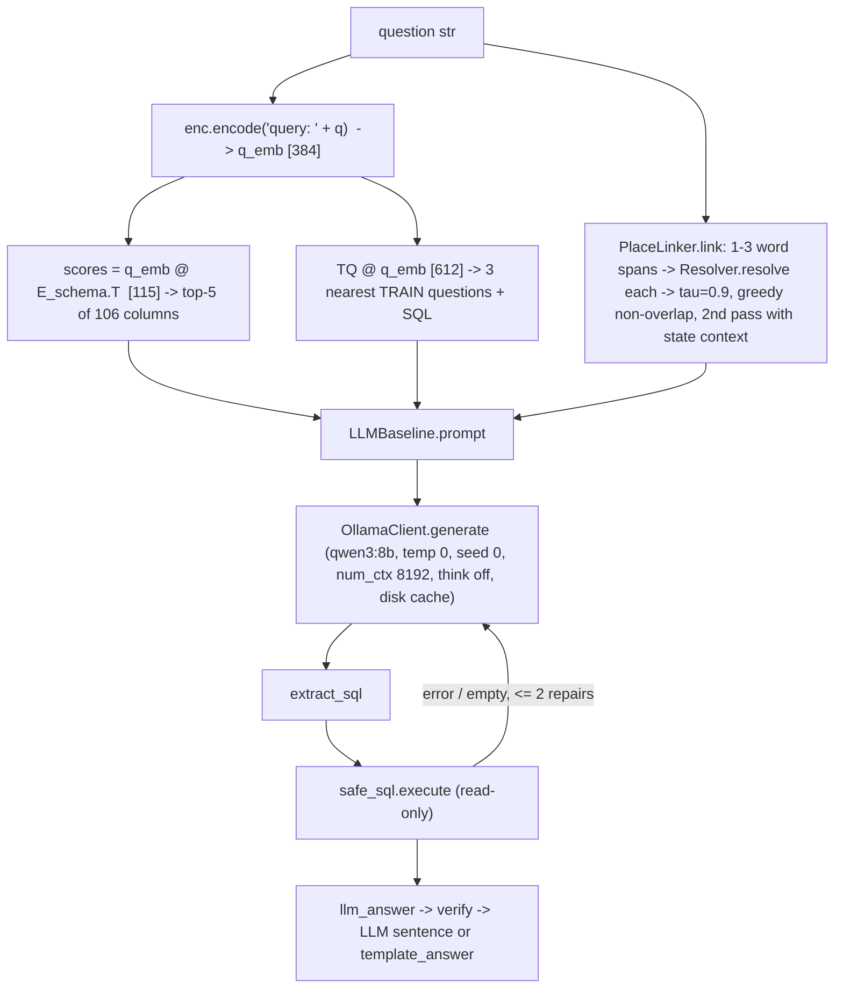

# INGRES — Baseline Audit of the Original System

**Audited state:** git tag `baseline-v1` (commit `79ec245`, 2026-10-15). **Audit date:** 2026-11-17.
This document describes the system *before* the modernization work. It is frozen: later changes are recorded in
`docs/09_CHANGELOG_AND_EVIDENCE.md`, never here.

Evidence labels: `CODE` (read in source), `CONFIG` (config/metadata file), `RUNTIME` (observed by running code),
`BENCH` (measured by a benchmark script with stored output), `DOC` (stated only in project docs), `INFERRED`.

---

## 1. What INGRES is

| Item | Finding | Evidence |
|---|---|---|
| Problem | Answer questions about India's official groundwater assessments (INGRES, CGWB + IIT Hyderabad) asked in English, Hindi, Hinglish (romanised, code-mixed) or Tamil | `README.md` §1; `src/baselines/llm.py:243` (`SYSTEM`) — DOC + CODE |
| NLP task | **Multilingual Text-to-SQL** over one fixed SQLite schema, plus answer verbalisation with a numeric faithfulness check | `src/pipeline/agent.py` — CODE |
| Input | One free-text question (≈12 words on average in the benchmark) | BENCH (`experiments/perf/baseline_components.json`: mean 11.7 words) |
| Output | A single read-only `SELECT`, its result rows, and a one–two sentence answer in the question's language (or a deterministic table rendering if the sentence fails verification) | `Pipeline.answer` (`src/pipeline/agent.py:151`), `grounded_answer` (`src/grounding/verifier.py:98`) — CODE |
| Target users | Officials, journalists, researchers, farmers | DOC only (`PROJECT_OVERVIEW.md` §1). No user study exists — INFERRED audience |
| Success criterion | Execution accuracy (EX) on INGRES-Bench: predicted SQL result equals gold SQL result | `src/evaluation/execution.py:67` — CODE |
| Interfaces | Streamlit page (`app/streamlit_app.py`); experiment CLIs under `scripts/`; no HTTP API | CODE |

## 2. Repository inventory

151 tracked files; 5,690 lines of Python across `src/` (13 packages), `scripts/` (16 entry points), `app/` and `tests/` (RUNTIME: `git ls-files`, `wc -l`).

| Area | Files | Role |
|---|---|---|
| Data layer | `src/ingestion/{ingres_api,flatten,build_db}.py`, `src/normalization/crosswalk.py`, `scripts/{crawl_ingres,audit_data,build_schema,snapshot_raw}.py` | Crawl the INGRES JSON endpoint, flatten, cross-year unit linking, build `data/processed/ingres.db` (SQLite, 21.8 MB, git-ignored) |
| Safety | `src/utils/safe_sql.py` | Read-only executor: `mode=ro` URI + authorizer allow-list + 10 s progress-handler timeout + 10,000-row cap |
| Benchmark | `src/benchmark/{pool,lexicon,intents,build}.py`, `scripts/{build_benchmark,qc_benchmark,check_transliterations}.py`, `data/benchmark/*.jsonl` | INGRES-Bench v1: 371 items × 4 languages = 1,484 instances |
| Evaluation | `src/evaluation/{execution,report}.py` | EX metric, bootstrap CIs, breakdowns |
| Baselines | `src/baselines/{keyword,llm}.py`, `scripts/run_baselines.py`, `scripts/run_schema_linking_baselines.py` | Template retrieve-and-fill; LLM clients (Ollama, Gemini) and prompt |
| Schema linking | `src/schema_linking/{retrieval,train}.py`, `scripts/train_schema_linker.py` | BM25 / bi-encoder retrievers, contrastive fine-tuning |
| Entity resolution | `src/entity_resolution/{gazetteer,resolver}.py`, `scripts/train_entity_resolver.py` | Gazetteer, phonetic folding, LR ranker |
| Tokenization study | `src/tokenization/{metrics,mitigation}.py`, `scripts/run_tokenization_{study,mitigation}.py` | Fertility, CMI, translate-first, vocabulary adaptation |
| Grounding | `src/grounding/verifier.py`, `scripts/run_grounding.py` | Numeric verifier + template fallback |
| Pipeline | `src/pipeline/agent.py`, `scripts/run_pipeline.py` | Full system + ablations + error analysis |
| UI | `app/streamlit_app.py` | Demo |
| Tests | `tests/` (10 files, 61 tests, all passing at baseline) | RUNTIME |

**Not in git (regenerable or local only):** raw crawl, `ingres.db`, model checkpoints (`experiments/**/checkpoints/`),
LLM response cache (`cache/llm/`, 5,360 files), `.env`.

## 3. End-to-end pipeline as implemented (`Pipeline.sql` → `Pipeline.answer`)

| Step | Code | Data shape / type | Evidence |
|---|---|---|---|
| Query embedding | `agent.py:123` | tokens `[1, T]` → hidden `[1, T, 384]` → mean-pool `[1, 384]` → L2-normalised | RUNTIME (`experiments/forensics/models.json` → `shape_trace_schema_linker`: T = 23 for the sample question) |
| Schema ranking | `agent.py:125-127` | schema matrix `[115, 384]` (106 columns + 9 tables); scores `[115]`; top-5 columns | RUNTIME |
| Example retrieval | `agent.py:105-107` | train matrix `[612, 384]`; 3 nearest; rendered nearest-last | CODE |
| Place linking | `agent.py:51-74` | ≤ 3·n spans, each one `Resolver.resolve` call (TF-IDF top-30 + LR over 12 features) | CODE |
| Prompt | `llm.py:282-292` | compact schema + conventions + examples + column hints + place hints + question; mean 2,892 prompt tokens on test | CODE + `experiments/pipeline/results.json` |
| Generation | `llm.py:134-166` | one HTTP POST to `127.0.0.1:11434/api/chat`, non-streaming, `num_predict` 512 | CODE |
| Execution + repair | `agent.py:109-146` | error or empty/NULL result → feedback turn, max 2 | CODE |
| Answer + verification | `verifier.py:59-104` | every number in the sentence must match a result value (with unit conversions) | CODE |

## 4. AI/ML components found

| # | Component | Identity | Training status | Where loaded |
|---|---|---|---|---|
| 1 | LLM | `qwen3:8b` via Ollama (GGUF, Q4_K_M per `ollama show`, digest prefix `500a1f067a9f` in October) | Pretrained, prompted only | `OllamaClient` (`llm.py:118`) |
| 2 | Schema-linker encoder | `intfloat/multilingual-e5-small` fine-tuned → `experiments/schema_linking/checkpoints/finetuned_e5` | Fine-tuned by this project (all weights) | `agent.py:96` |
| 3 | Mention/alias embedder | `intfloat/multilingual-e5-small` (HF revision `614241f6…`), off-the-shelf | Pretrained | `agent.py:102` |
| 4 | Entity ranker | scikit-learn `LogisticRegression`, 12 features | Trained by this project | `ranker.pkl` (`agent.py:39`) |
| 5 | Candidate generator | `TfidfVectorizer(char_wb, 2–4-grams)` over folded aliases | Fitted on the gazetteer | `resolver.py:36` |
| 6 | Vocabulary-adapted encoder | e5-small + 78 added tokens | Fine-tuned (experiment only; **not used by the pipeline**) | `scripts/run_tokenization_mitigation.py` |
| 7 | Language tagger | `MultinomialNB` over char n-grams + lexicons | Fitted on train-template words (study only) | `tokenization/metrics.py:60` |
| 8 | Keyword baseline retriever | `TfidfVectorizer` (char 2–4) over train questions | Fitted on train | `baselines/keyword.py:146` |
| 9 | Tokenizers compared | XLM-R (e5), `Qwen/Qwen3-8B`, `bert-base-multilingual-cased`, `google/muril-base-cased`, `Xenova/gpt-4o` | Tokenizers only | `scripts/run_tokenization_study.py:26` |
| 10 | Gemini client | `gemini-3.6-flash` | Implemented; **1 successful call ever** (free-tier quota 20/day) | `llm.py:43`; `experiments/baselines/results.json` |

Exact parameter counts and configurations are in `docs/01_MODEL_SPECIFICATIONS.md` (computed by `scripts/model_forensics.py`).

## 5. Baseline quality (as stored at `baseline-v1`)

All numbers: `experiments/pipeline/results.json`, `experiments/baselines/results.json` — BENCH.

| System | test EX (n=384) | hard_test EX (n=260) |
|---|---|---|
| A keyword/template | 32.6% | 30.8% |
| D qwen3:8b zero-shot | 18.0% | 13.1% |
| **Full pipeline** | **71.9%** [67.4, 76.0] | **57.7%** [51.9, 63.8] |

Full pipeline by language (test): English 78.1, Hindi 69.8, Hinglish 77.1, Tamil 62.5.
Components: schema-linker column R@3 0.896; resolver top-1 0.973 on ambiguous names with context, 0.645 on hand-written
Tamil with context; place linker dev F1 0.852 (Tamil 0.65); verifier 98.1% detection, 0% false alarms.

## 6. Baseline performance (measured on the baseline code)

`python scripts/benchmark_perf.py --label baseline --stage components|llm|e2e`, run from a worktree of `baseline-v1`
on 2026-11-19 → `experiments/perf/baseline_*.json`. Hardware: AMD Ryzen 7 9700X (16 logical cores), 32 GB RAM,
RTX 5060 8 GB, Windows 11; encoders on CPU (`torch 2.14.0+cpu`). Components: 200 TEST questions (50 per language);
LLM and end-to-end: 100 TEST questions; 5 warm-up requests on DEV questions; batch size 1; no concurrency.

| Stage (per question, before the LLM) | mean | median | p95 | p99 |
|---|---|---|---|---|
| Query encoding (fine-tuned e5) | 8.50 ms | 8.48 ms | 9.79 ms | 11.10 ms |
| Schema ranking (dot product + sort) | 0.06 ms | 0.06 ms | 0.07 ms | 0.08 ms |
| **Place linking** | **107.16 ms** | 104.81 ms | 192.41 ms | 219.26 ms |
| Example retrieval | 0.06 ms | 0.06 ms | 0.07 ms | 0.09 ms |
| **Total before the LLM** | **115.78 ms** | 113.22 ms | 202.77 ms | 229.06 ms |

| Cold start | seconds |
|---|---|
| Load fine-tuned encoder | 0.48 |
| Load base encoder | 4.50 |
| **Build place linker** (gazetteer, TF-IDF, embed all 16,681 aliases) | **14.27** |
| Build schema index + embed 612 train questions | 2.88 |
| **Total** | **22.13** |

| LLM and end to end | value |
|---|---|
| LLM request (stream) median / mean / p95 | 2,009 / 2,198 / 3,314 ms |
| Time to first token, median | 281 ms |
| Generation / prompt processing | 51.7 / 8,762 tokens/s |
| `Pipeline.sql` end to end, median / p95 | 2,085 / 3,468 ms |
| Non-LLM overhead, mean | 120.9 ms |
| LLM share of end-to-end time | 94.7% |

Process memory: 1,295 MB after load, peak 1,378 MB. Encoder throughput: 141 queries/s at batch 1, 298 at batch 32.

_Correction note:_ an earlier, preliminary run on 2026-11-17 reported 144 ms pre-LLM and 24.7 s cold start. That run
used measured questions as warm-up and ran while other GPU applications were active, so it is superseded by the
numbers above. The method is described in `docs/04_BENCHMARKS_AND_PERFORMANCE.md`.

## 7. Findings

### 7.1 Bugs (verified)

| ID | Severity | Finding | Evidence |
|---|---|---|---|
| B1 | **High** | **Tamil romanisation is wrong.** `romanise()` uses `sanscript.transliterate(TAMIL → ISO)`, which maps Tamil stops to voiced aspirates: கர்நாடகா → `gharnadhagha` (should be `karnataka`), திரிபுரா → `dhiribhura`, மதிப்பீட்டில் → `madhibhbhidhdhil`. Tamil-script place names therefore almost never match INGRES spellings (resolver scores 0.03–0.32 for state names, far below τ = 0.9). The same function is duplicated in `src/baselines/keyword.py:31` and `src/entity_resolution/gazetteer.py:28` | RUNTIME: resolver probe (see changelog E-01); 58 of the 90 un-linked Tamil place mentions on test + hard_test are *state* names |
| B2 | Medium | **Year rule fails for Tamil.** `extract_years` (keyword baseline) expects the romanised stem `matippitt`; because of B1 it never matches. Rule accuracy vs gold SQL years: English/Hinglish 100%, Hindi 97.5%, **Tamil 77.6%** (test + hard_test) | RUNTIME (changelog E-02) |
| B3 | Medium | **Error-analysis categories overstate place errors.** `error_category` assigns "place not linked" whenever the linker missed a gold place, before looking at the SQL. In 31 of those 90 errors the SQL nevertheless contains every gold place literal, so the place was not the cause | RUNTIME (changelog E-03) |
| B4 | Low | Devanagari anusvara is romanised as `m` before non-labials (बंगाल → `bamgala`), lowering similarity to `Bengal` | RUNTIME |
| B5 | Low | `OllamaClient.generate` retries on any `URLError` (which includes HTTP 4xx/5xx) and finally raises "server not reachable", hiding the real HTTP error | CODE `llm.py:147-156` |
| B6 | Low | LLM cache key = hash(model tag + messages + options). It does not include the model digest or Ollama version, so a re-pulled `qwen3:8b` with different weights would silently reuse old answers | CODE `llm.py:141` |
| B7 | Low | `requirements.txt` pins `numpy==1.26.4`; the environment now has numpy 2.5.3 (dependency drift since October). Tests still pass | RUNTIME (`pip list`) |

### 7.2 Design weaknesses and bottlenecks

| ID | Finding | Evidence |
|---|---|---|
| D1 | Place linking makes one resolver call (one transformer forward pass + ≈30 `SequenceMatcher` pairs ×2) **per span**, sequentially: 107 of the 116 ms spent before the LLM | BENCH §6 |
| D2 | All 16,681 gazetteer aliases are re-embedded at every start-up: most of the 14.3 s place-linker build, in a 22.1 s cold start | BENCH §6 |
| D3 | Two copies of e5-small are held in memory (fine-tuned for linking, base for mentions): ≈470 MB of weights each | RUNTIME (`models.json`: 470,615,040 bytes each) |
| D4 | 147,840 pooler parameters and 35 embedding rows of e5-small are loaded but never used (mean pooling; tokenizer has 250,002 entries vs 250,037 rows) | RUNTIME (`models.json`) |
| D5 | The LLM dominates latency (94.7% of the 2.09 s median per question); requests are strictly serial; no streaming in the UI | BENCH + CODE |
| D6 | The headline 71.9% rests on retrieved examples (−36.5 points without them) while 376/384 test instances share their question type with TRAIN. No evaluation isolates unseen question types for the *pipeline* | `docs/PIPELINE.md` §3 — BENCH |
| D7 | The year convention ("the N assessment" = `'(N-1)-N'`) is left to the LLM: 55 of 644 pipeline SQLs have a wrong year set (EX among them 21.8%); a deterministic rule is right on 45 of those 55 | RUNTIME (changelog E-02) |
| D8 | CIs are computed over instances, but the 4 language versions of an item are correlated → intervals are optimistic | DOC (acknowledged) |
| D9 | Training of both learned components used a single seed; CPU only | DOC + CONFIG |

### 7.3 Dead or unused code

| Item | Status |
|---|---|
| `schema_prompt` (`llm.py:206`) | Used only by the Gemini path, which cannot be evaluated on the free tier |
| `GeminiBaseline` alias (`llm.py:300`) | Unreferenced |
| `code_mix_proxy`, `cm_bin` (`evaluation/report.py`) | Used only inside `enrich` for the Phase 4 report; superseded by `LanguageTagger.cmi` |
| `add_history_aliases` (`gazetteer.py:92`) | Defined, never called |
| `romanise` / `fold` | Duplicated in `keyword.py` and `gazetteer.py` |

### 7.4 Security review

| Risk | Status | Evidence |
|---|---|---|
| SQL injection / destructive SQL from LLM output | **Mitigated**: read-only URI, authorizer allow-list (SELECT/READ/FUNCTION/RECURSIVE), denied functions, timeout, row cap; 13 tests | `safe_sql.py`, `tests/test_safe_sql.py` — CODE + RUNTIME |
| Prompt injection via the question | Can change the SQL but not escape read-only access; can influence the answer sentence, whose numbers are still verified | INFERRED from code paths |
| Secrets | `.env` git-ignored; only `.env.example` tracked | RUNTIME (`git ls-files`) |
| `pickle.load` of `ranker.pkl` | Executes arbitrary code if the file is replaced; file is local and tracked in git | CODE `agent.py:39` |
| Data exposure | All data is public; nothing leaves the machine with the Ollama backend | CODE |
| Denial of service | One query at a time; heavy SQL bounded by the 10 s timeout | CODE |

### 7.5 Implemented vs partial vs described only

| Capability | Status |
|---|---|
| Crawl, DB build, crosswalk, read-only executor | Implemented, tested |
| INGRES-Bench + QC | Implemented, tested |
| Schema linker, entity resolver, place linker | Implemented, evaluated |
| Repair loop, numeric verifier, UI | Implemented, tested |
| Gemini / frontier-model baseline | **Implemented but not evaluated** (quota) |
| Level hints for place resolution ("block", "ज़िला") | **Described as future work only** (`docs/ENTITY_RESOLUTION.md`) |
| Historical-spelling aliases in the live gazetteer | **Code exists, not wired** (`add_history_aliases`) |
| Native-speaker validation, back-translation check | **Not done** |
| HTTP API, authentication, concurrency, monitoring/logging | **Absent** |
| GPU training | **Not used** (CPU build of torch) |

### 7.6 Potentially misleading metrics

1. **"41% of errors are place errors"** (B3): an upper bound; 59 of 218 errors (27%) have SQL that lacks a gold place literal.
2. **71.9% EX** (D6): valid for the benchmark's distribution; not evidence of performance on unseen question types or real users.
3. **Keyword baseline 38.8%**: uses the benchmark's own metric/category lexicon (documented as optimistic).
4. **Resolver "Tamil is weakest because the script lacks voicing"** (`docs/ENTITY_RESOLUTION.md`): incomplete — the dominant cause is bug B1.
5. **LLM latency** values in result files are per-call times recorded inside the client and are replayed from cache on re-runs; they are not wall-clock end-to-end times.
