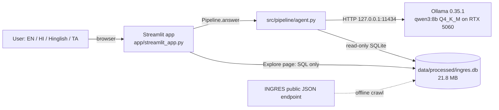
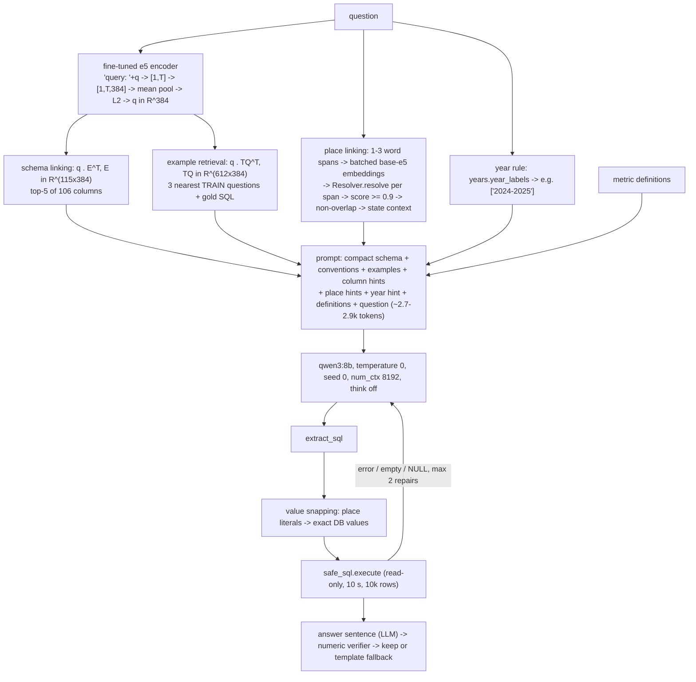

# INGRES — Architecture and Data Flow

Current system: `main` after the November 2026 modernization (pipeline configuration **v3**). The original system is
git tag `baseline-v1` and is described in `docs/00_INGRES_BASELINE_AUDIT.md`. Line numbers refer to the current code.

## 1. System context



All computation is local. Nothing is sent to a third party at question time.

## 2. Offline data pipeline (built once)

```mermaid
flowchart LR
  A[POST /api/gec/getBusinessDataForUserOpen] -->|scripts/crawl_ingres.py<br/>5,299 requests, 0.5 s apart| B[data/raw/ingres_api/*.json.gz]
  B -->|src/ingestion/flatten.py| C[facts_long.parquet<br/>6,217,844 rows, 235 field paths]
  C -->|src/normalization/crosswalk.py<br/>UUID, name, name-in-state, guarded fuzzy| D[canonical ids]
  D -->|src/ingestion/build_db.py| E[(ingres.db: 9 tables)]
  E -->|scripts/build_benchmark.py, seed 7| F[INGRES-Bench v1<br/>1,484 instances]
```



| Table | Rows | Key columns |
|---|---|---|
| `assessment_years` | 5 | assessment_year, gwra_year, caveat |
| `states` | 37 | state_id, state_name |
| `districts` | 770 | district_id, district_name, state_id |
| `assessment_units` | 8,751 | unit_id, unit_name, unit_type, district_id, state_id |
| `state_assessments` | 185 | 24 metric columns |
| `district_assessments` | 3,659 | same metrics |
| `unit_assessments` | 34,565 | same metrics + category, ingres_uuid |
| `state_unit_granularity` | 187 | unit type and count per state and year |
| `location_crosswalk` | — | cross-year links (bookkeeping, not shown to the LLM) |

## 3. Online question pipeline (v3)



### Step by step with code locations

| # | Step | Function (file:line) | Input → output |
|---|---|---|---|
| 1 | Encode question | `Pipeline.sql` (`agent.py:143`) | str → 384-d unit vector (fine-tuned e5, CPU, ≈9 ms) |
| 2 | Schema hints | `agent.py` (in `sql`) | scores over 115 elements → 5 column keys, e.g. `district_assessments.extraction_total_ham` |
| 3 | Place linking | `PlaceLinker.link` (`agent.py:63`) | spans (≤3·words) → batched embeddings → `Resolver.resolve` (`resolver.py:116`) → list of {mention, level, db_name, district, state, score} |
| 4 | Retrieved examples | `Pipeline._examples` (`agent.py:123`) | 612 train similarities → 3 (question, SQL) pairs, most similar last |
| 5 | Year rule | `years.year_labels` (`years.py:20`) | e.g. "2025 ke assessment" → `['2024-2025']` |
| 6 | Prompt | `LLMBaseline.prompt` (`llm.py:284`) | schema, conventions, examples, hints, `extra` (places + year + definitions), question |
| 7 | Generate | `OllamaClient.generate` (`llm.py:134`) | chat messages → text (disk-cached by SHA-256 of model + messages + options) |
| 8 | Extract SQL | `extract_sql` (`llm.py:250`) | first ```sql block |
| 9 | Value snapping | `ValueSnapper.snap` (`values.py:69`) | SQL → SQL with place literals replaced by stored values + list of changes |
| 10 | Execute | `safe_sql.execute` (`safe_sql.py:50`) | rows or error |
| 11 | Repair | `agent.py` (in `sql`) | problem text appended as a user turn; stops if the model repeats itself |
| 12 | Answer | `grounded_answer` (`verifier.py:98`) | LLM sentence → `verify` (`verifier.py:59`) → sentence or `template_answer` |

## 4. Tensor shapes (fine-tuned linker; measured on the question "2024-25 में लुधियाना जिले में कुल भूजल निकासी कितनी थी?")

| Tensor | Shape |
|---|---|
| input_ids / attention_mask | [1, 23] |
| last hidden state | [1, 23, 384] |
| pooled + normalised question vector | [1, 384], L2 norm 1.0 |
| schema matrix E | [115, 384] (106 columns + 9 tables) |
| schema scores | [1, 115] |
| train-question matrix TQ | [612, 384] |
| alias matrix (base e5, resolver) | [16,681 aliases, 384] float32 = 24.4 MiB, cached in `cache/alias_emb/*.npy` |

Source: `experiments/forensics/models.json` → `shape_trace_schema_linker`.

## 5. Process and memory layout

| Object | Size | Lifetime |
|---|---|---|
| Fine-tuned e5 (schema linker, examples) | 470.6 MB float32 | process |
| Base e5 (mention embeddings) | 470.6 MB float32 | process |
| Alias embedding matrix | 24.4 MiB (16,681 × 384 float32) | process; cached on disk |
| TF-IDF indexes (2 spaces) | sparse | process |
| SQLite connection | read-only, `check_same_thread=False` | process (one per app) |
| qwen3:8b | 6.2 GB reported by `ollama ps` (weights + 8k-token KV cache) | Ollama process, unloaded after 5 min idle |

Measured RSS of the Python process after loading: 1,182 MB for v3 (1,295 MB for baseline-v1, which computed the alias matrix at start-up); `experiments/perf/*_components.json`.

## 6. Failure handling

| Failure | Behaviour |
|---|---|
| Ollama not running | UI disables the chat box and shows "LLM offline"; Explore and Results still work |
| Ollama HTTP error (e.g. model not pulled) | raised immediately with the server message (changed: previously retried 5× and reported "not reachable") |
| SQL error / empty result | fed back to the model, up to 2 repairs |
| Write / dangerous SQL | refused by the SQLite authorizer (`UnsafeSQL`), counted as a failed attempt |
| Slow SQL | progress handler aborts after 10 s |
| Answer sentence with an unsupported number | replaced by a deterministic table rendering; UI shows a warning |
| Unknown place name | left unchanged by value snapping; usually returns no rows, which triggers repair |
